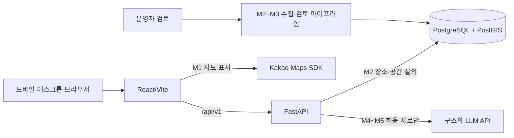

# 시스템 구조

M0에서 동작하는 경로는 브라우저 → React → FastAPI health뿐이다. DB는 개발용 Compose로 준비하며 앱 연결·모델·마이그레이션은 M2 작업이다.

## 책임 경계

- React는 지도·필터·상세·검색 UI와 상태를 담당한다. TanStack Query가 API 요청 상태를, Router가 화면 이동을 맡는다.
- FastAPI는 `/api/v1` 요청 검증, 장소 공개 정책, 근거 조회와 추천 오케스트레이션을 담당한다. 외부 키는 서버에만 둔다.
- PostgreSQL/PostGIS는 장소, 외부 식별자, 위치, 출처, 특징, 수집 이력을 저장하고 반경 후보를 질의한다.
- Kakao SDK는 M1부터 지도 표시만 담당한다. 지도 데이터 이용 조건과 표시 의무는 연결 전에 확인한다.

## 데이터 수집·게시 흐름 (M2~M3)

공식 API/허용 데이터 → 출처별 권한 확인 → 후보 수집 → 외부 ID와 위치로 중복 점검 → 운영자 검토 → `published` 전환 → 출처·확인 날짜를 포함해 공개한다. 권한이 불명확한 본문·후기는 수집하지 않는다. 정정·폐업 신고는 상태와 근거를 재검토한다.

## 자연어 검색·추천 흐름 (M4~M5)

입력 검증 → 구조화된 검색 조건 → SQL/PostGIS 후보 조회 → 검증 상태·최신성 필터 → 규칙 기반 점수 → 후보 ID와 근거만 LLM에 전달 → Pydantic 출력 검증 → 근거 ID 대조 → 응답. 후보가 없거나 근거가 부족하면 이유를 만들지 않고 빈 결과/불확실성을 반환한다.

## 오류·설정 관리

API는 요청 오류 422, 미존재 404, 외부 의존 장애 503 등 의미 있는 상태 코드를 사용한다. 프론트는 로딩·빈 결과·오류를 구분한다. 서버 설정은 `backend/app/core/config.py`에서 환경변수로 읽고, 브라우저 공개 설정은 `frontend/.env`의 `VITE_` 값으로 분리한다. root `.env`는 백엔드용이며 Git에서 제외한다. 비밀정보는 응답·로그에 출력하지 않는다.

## 지역 확장

지역 코드는 설정과 추후 지역 테이블로 관리한다. M1 초기 중심은 사용자가 지정한 다산지금로146번길 117의 Kakao 지도 주소 지점으로 검증해 프론트 환경 설정에 등록했다. 지도 화면이 이 값을 읽어 표시하는 작업은 M1에서 진행한다. 장소 UUID와 외부 API ID를 분리해 공급자 변경에 대응하고, 공간 인덱스로 다산동 → 남양주 → 서울·경기 → 전국의 조회 범위를 확장한다.
